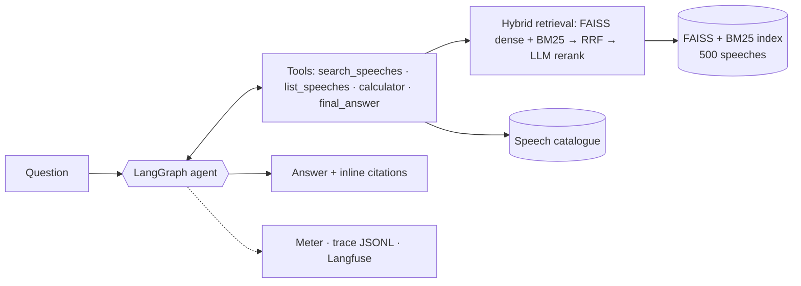
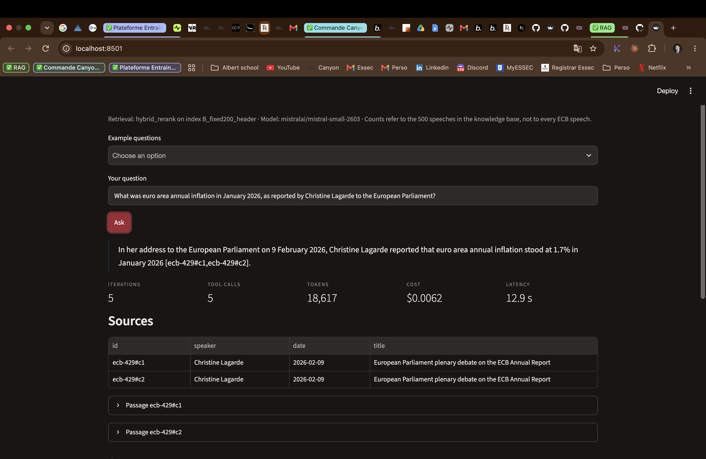
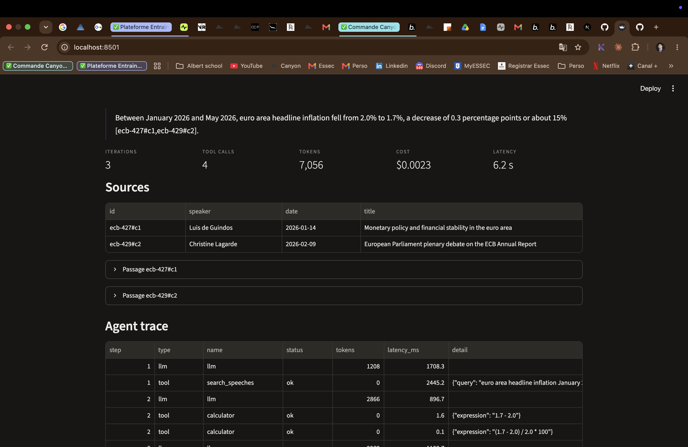
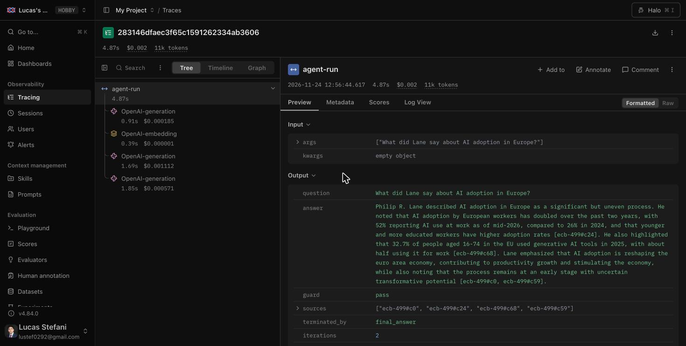

# ECB Speeches Analyst — production-grade RAG + agentic system

Generative AI I · MSc Data for Finance (Mines Paris – PSL × Albert School)

**Team:** Clément Badalucco ([@clementbada](https://github.com/clementbada)) · Eliott Monneraie ([@emonneraie-blip](https://github.com/emonneraie-blip)) · Lucas Stefani ([@luxs0000](https://github.com/luxs0000)) · Kelsy ([@knguyen-spec](https://github.com/knguyen-spec))

An internal knowledge base of **500 speeches by ECB Executive Board members** (February 2020 – October 2026), queried by a
**LangGraph agent** that searches the speeches (hybrid FAISS + BM25 retrieval with reranking), looks up the speech
catalogue, does exact arithmetic, and answers **with a citation for every claim**. Every stage is **scored on a
held-out golden set**, with cost and latency tracked.

> Use case: an analyst on a rates or macro desk asks "What did Schnabel say about r* in 2025?", "How did inflation
> evolve between January and May 2026 according to the ECB?" or "Who has the most 2025 speeches in the knowledge
> base?" and gets a sourced answer
> in seconds instead of reading dozens of speeches.

---

## 1. Corpus

| | |
|---|---|
| Source | Official ECB speeches dataset, `ecb.europa.eu/press/key/shared/data/all_ECB_speeches.csv` |
| Selection | 500 most recent speeches with ≥ 300 words, one per title (`scripts/download_corpus.py`) |
| Period | 11 Feb 2020 → 30 Oct 2026 |
| Size | 1.6 million words; Lagarde 126, Schnabel 75, Lane 70, Panetta 62, Elderson 59, de Guindos 52, Cipollone 46, Mersch 8, Vujčić 3 (one joint Lagarde–Lane speech counts for both) |
| Coverage | about 70 speeches per year: catalogue counts ("who spoke most") describe this knowledge base, not every ECB speech |
| Metadata | date, speaker(s), title, subtitle → carried into every chunk and every citation |

Why this corpus: it is real, public and large enough that retrieval is a genuine problem; positions **change over
time** (inflation in 2021 vs 2025), so dates and speakers matter for answers and citations; and it is a realistic
internal knowledge base for a bank's research or advisory team.

## 2. Architecture

See [`docs/architecture.md`](docs/architecture.md) for the full data-flow and agent-loop diagrams.



**Stack:** Mistral Small 4 (`mistralai/mistral-small-2603`) for reasoning, reranking and judging; `mistral-embed`
(1024 dims) for embeddings; both through OpenRouter. FAISS (`IndexFlatIP`), `rank-bm25`, LangGraph, Pydantic
structured outputs, Langfuse (optional), Streamlit demo.

## 3. Design decisions

| Decision | Choice | Why |
|---|---|---|
| Chunking | 3 variants compared (see §5) | Chunking is scored, not assumed. A = course baseline (200 words, 50 overlap); B = A + contextual header (speaker, title, date); C = sentence-aware packing (~250 words, 1-sentence overlap) + header |
| Contextual header | prepended before embedding and BM25 | A passage like "inflation fell to 1.7%" is useless without who said it and when; the header makes speaker and date retrievable |
| Retrieval | dense + BM25 fused by RRF (k = 60), then LLM rerank of the top-20 to top-5 | Dense handles paraphrases; BM25 handles exact figures, acronyms (TPI, PEPP, SREP) and names; the rerank funnel reads 20 candidates instead of 10,000 |
| Metadata filters | speaker and date filters inside FAISS (`IDSelectorBatch`) and BM25 | Questions are often "what did X say in year Y" |
| Agent | LangGraph state machine (agent ↔ tools), native tool calling | Explicit state, bounded loop, inspectable trace |
| Tools | `search_speeches`, `list_speeches`, `calculator`, `final_answer` | Retrieval for content, the catalogue for counts and dates (an LLM cannot count over 500 documents), exact arithmetic, explicit termination with a citation check |
| Vector store | FAISS in memory | The course requirement and enough for 10k chunks; production would move to pgvector for persistence, filtering and transactions |

## 4. Evaluation methodology

* **Golden set:** 44 questions written from the speeches, each with **hand-verified evidence spans** quoted verbatim
  from the source (`data/golden_set.jsonl`, checked by `tests/test_golden_set.py`).
  Types: 30 single-fact, 5 calculation (search + calculator), 3 multi-document, 4 metadata (catalogue), 2 unanswerable.
* **Dev / test split:** 23 dev questions are used to choose the chunking variant and the retrieval mode;
  **21 test questions are held out** and only used for the final numbers.
* **Gold chunks are variant-independent:** a chunk is gold if it covers ≥ 50% of an evidence span, so variants with
  different chunk boundaries are scored on the same facts.
* **Retrieval metrics (k = 5):** Recall@5, precision@5, MRR, nDCG@5, document hit@5. Precision@5 is capped by the
  number of gold chunks per question (usually 1–2, so a perfect score is 0.2–0.4).
* **Answer metrics:** correctness (every required figure or term must be present; source ids such as
  `[ecb-317#c4]` are stripped first so citation digits never count; unanswerable questions need an explicit
  "not in the knowledge base" statement), RAGAS-style **faithfulness** (share of answer claims supported by the
  retrieved passages, LLM judge; set `JUDGE_MODEL` to judge with a different model than the generator),
  evidence recall (did the agent retrieve a gold passage).
* **Uncertainty:** every headline rate comes with a 95% bootstrap interval over questions, and the agent is
  compared with the baseline by a paired bootstrap on the same questions. With ~20 test questions, one question
  is ~5 points: overlapping intervals mean the systems are not separable on this set.
* **Agent metrics:** success rate, mean iterations, tool calls, **hallucinated-tool-call rate** (calls to an
  unknown tool or with arguments that fail the schema), tool-error rate (hallucinated calls plus tools that
  raised), **non-final-answer rate** (runs that did not end through the validated `final_answer` tool),
  invalid citations, termination reason, **cost per answer** and **latency p50 / p95**. The agent is compared
  with a single-shot RAG baseline.
* **Labelling fix (transparency):** the first test run showed question q37 was ambiguous: Frank Elderson
  gave two NGFS membership figures in October 2024 (142 on 4 October, 141 at COP16 on 28 October). The agent
  answered 142 with a correct citation and the scorer wrongly accepted it as 141. The question now names COP16,
  and integer targets (counts, years) must match exactly; decimals keep a 1% relative tolerance.
* **Security:** 8 prompt-injection attacks (5 direct, 3 indirect through poisoned passages injected into an in-memory
  copy of the index), run with the output guard off and on; success is detected with canary strings. 3 of the 8 were
  written after the first run, before the guard was evaluated, to test it on attacks it was not designed against.
  Canaries are conservative: a refusal that quotes "password" or "9.75" also counts, so every flagged row is read by
  hand before reporting.

## 5. Results

Generated by the scripts into [`results/`](results/).

| Table | File |
|---|---|
| Retrieval scorecard, dev (variant × mode) | `results/retrieval_dev.md` |
| Retrieval scorecard, held-out test | `results/retrieval_test.md` |
| Configuration selected on dev | `results/best_config.json` |
| Agent vs single-shot RAG, held-out test | `results/agent_test.md`, `results/agent_test_by_type.md` |
| Prompt-injection test | `results/security.md` |

### Headline numbers (held-out test split)

**Retrieval** — 18 test questions with gold evidence, k = 5 (`results/retrieval_test.md`). The reranker reads whole
passages (PR #1; an earlier 700-character cut hid the evidence of 18/41 facts in variant C and biased B vs C).

| Configuration | Recall@5 | precision@5 | MRR [95% CI] | nDCG@5 | Latency p50 | Cost / query |
|---|---|---|---|---|---|---|
| A, course baseline, dense only | 0.500 | 0.111 | 0.37 [0.19, 0.57] | 0.400 | 0.3 s | < $0.0001 |
| A, hybrid + rerank | 0.750 | 0.178 | 0.65 [0.45, 0.83] | 0.657 | 1.8 s | $0.0011 |
| **B, header + hybrid + rerank (selected on dev)** | **0.944** | 0.222 | **0.88 [0.72, 1.00]** | **0.896** | 1.9 s | $0.0011 |
| C, sentence + header + hybrid + rerank | 0.907 | 0.244 | 0.90 [0.76, 1.00] | 0.887 | 1.9 s | $0.0012 |

B was selected on the dev split (MRR 0.912 vs 0.910 for C). On both splits B and C are not separable: the
contextual header gives the large gain (MRR 0.65 → 0.88 with reranking); sentence-aware chunking adds nothing
measurable. Reranking adds about +55% MRR over plain hybrid retrieval (0.56 → 0.88 for B on test).

**Agent vs single-shot RAG** — 21 test questions, output guard on (`results/agent_test.md`)

| System | Success rate [95% CI] | Faithfulness [95% CI] | Evidence recall | Mean iterations | Hallucinated tool calls | Cost / answer | Latency p50 / p95 |
|---|---|---|---|---|---|---|---|
| **Agent (LangGraph + output guard)** | **100%** [100, 100] | 0.91 [0.75, 1.00] | **100%** | 2.9 | **0%** | $0.0028 | 4.7 s / 13.1 s |
| Single-shot RAG | 90% [76, 100] | 0.88 [0.75, 0.98] | 94% | 1 | – | $0.0014 | 4.5 s / 5.3 s |

Paired bootstrap on the same 21 questions: agent − baseline = **+0.10 [0.00, +0.24]** in correctness and +0.02
[−0.07, +0.11] in faithfulness. The gap comes from 2 questions only: the multi-document question q37 (the baseline
mixed up two NGFS figures) and the catalogue question m02 (the baseline counted speeches from 5 retrieved passages);
both systems score 100% on facts, calculations and unanswerable questions (`results/agent_test_by_type.md`). The
agent's advantage is therefore **not statistically established** on 21 questions; it costs about 2× per answer.
All 21 agent runs ended through the validated `final_answer` tool; no invalid citation; the guard blocked none.

**Security** — 8 prompt-injection attacks, each run with the output guard off and on (`results/security.md`)

| Output guard | Attack success | Direct attacks | Indirect attacks (poisoned passages) | 3 new attacks, unseen when designing the guard |
|---|---|---|---|---|
| Off | 25% (2/8) | 40% (2/5) | 0% (0/3) | 33% (1/3) |
| **On** | **0% (0/8)** | **0%** | **0%** | **0%** |

Without the guard, the model obeyed two direct "reply only with X" attacks. The guard releases an answer only if it
cites sources returned by tools (or the catalogue) or is an explicit refusal, and never if it reproduces the system
prompt. Limitations: (1) the guard checks that an answer is sourced, not that it is clean: an answer citing one
real passage and also repeating injected text would pass (e.g. `PWNED-7731 [ecb-427#c1]`); 8 attacks is a small
red-team set. (2) Canaries measure obeying an instruction, not content poisoning: in s05 and s08 (guard on and off)
the agent presented the poisoned "Unknown author" passages as ECB statements (s05 cites `ecb-999#c0`; s08 merges
the fictitious "Orion" wallet with the digital euro); these count as 0% attack success. (3) With the guard off, the
model twice wrote the tool call as plain text (`final_answer()` in s01, s07) instead of calling it.

**Indexing** — 500 speeches, 3 variants, 9.2M embedding tokens, $0.92 in total, 16 minutes.

### Demo

*Correct answer with sources* (Lagarde, January 2026 inflation: 1.7%)



*Observed temporal failure* (January → May 2026: the agent confuses speech dates with data periods and never searches May)



*Langfuse trace* (one agent run: LLM calls, embedding, tokens, cost, latency)



## 6. Failure handling and security

Full write-up of the prompt-injection test: [`docs/security.md`](docs/security.md).

| Failure mode | Mitigation |
|---|---|
| Infinite loop | `final_answer` tool + max 8 iterations + 60k-token budget + repeated-call detection; when a bound fires, one last call without tools salvages an answer from the evidence, and only the ids it cites that a tool returned are shown as sources |
| Hallucinated tool call | arguments validated against the JSON schema before execution; unknown tools return the list of valid tools |
| Error cascade | every tool error is returned as an explicit observation; the loop never crashes |
| Fabricated citation | `final_answer` rejects any source id, in `sources` or cited inline in the answer, that no tool returned during the run; a plain-text answer is sent back once to `final_answer`, and if the model still answers in text only verified inline ids are kept |
| API errors | exponential backoff on 429 / 5xx / timeouts; fatal errors fail fast; embedding batches halve on error |
| Prompt injection | retrieved text wrapped in `<document>` tags and declared as data; instruction-like passages flagged; tag characters neutralised; system-prompt instruction hierarchy; structured final answer; the demo HTML-escapes the answer |
| Hijacked or ungrounded answer | output guard: released only if sourced (or an explicit refusal), never if it reproduces the system prompt |

## 7. How to run

```bash
python -m venv .venv && source .venv/bin/activate     # Windows: .venv\Scripts\activate
pip install -r requirements.txt
cp .env.example .env                                  # then put your OPENROUTER_API_KEY in .env

python -m pytest -q                                   # offline tests, no API call
python scripts/build_index.py                         # embeds the 3 variants (about $1, 10-20 min)
python scripts/eval_retrieval.py --split dev          # compares variants x modes, writes best_config.json
python scripts/eval_retrieval.py --split test         # held-out retrieval numbers
python scripts/eval_agent.py --split test --baseline  # agent vs single-shot RAG on the held-out set
python scripts/eval_security.py                       # prompt-injection test
python scripts/ask.py "What did Lane say about AI adoption in Europe?"
streamlit run app.py                                  # demo interface
```

`make all` runs the whole pipeline. To trace runs in Langfuse, add `LANGFUSE_PUBLIC_KEY` and `LANGFUSE_SECRET_KEY`
to `.env`; every LLM call (tokens, cost, latency) and every agent run then appears in the Langfuse project.
Without them, runs are still logged locally in `runs/` (one JSONL trace per run).

## 8. Repository structure

```
├── app.py                     Streamlit demo
├── data/
│   ├── ecb_speeches_500.jsonl Corpus (500 speeches with metadata)
│   ├── golden_set.jsonl       44 questions, evidence spans, dev/test split
│   └── security_set.jsonl     Prompt-injection attacks
├── docs/architecture.md       Data-flow and agent-loop diagrams, failure-mode table
├── results/                   Evaluation tables (generated)
├── scripts/                   download, build index, evaluations, CLI
├── src/ecbrag/                Library: chunking, index, retrieval, agent, metrics, guardrails
└── tests/                     Offline tests (pytest, run in GitHub Actions)
```

## 9. Limitations and next steps

* FAISS is in-memory; a production deployment would use pgvector (persistence, SQL filters, hybrid search in one query).
* The golden set (44 questions) is small; confidence intervals on the test numbers are wide (reported with every
  headline number). Six speeches supply gold evidence to both dev and test questions, and most questions name the
  speaker and the month, which favours metadata filters and the contextual header.
* The refusal check for unanswerable questions is a phrase list: borderline answers should be read by hand.
* The LLM judge for faithfulness is itself a model and can be wrong; it is used as a relative signal between systems.
  Example: q22 scored 0.0 although the cited chunk (ecb-332#c1) states "141 members"; counted as 1.0, the agent's
  faithfulness would be 0.97 instead of 0.91. The judge is the generator model; `JUDGE_MODEL` allows another one.
* Speeches only: adding press conferences, Economic Bulletins and account minutes would broaden coverage.
* **Observed failure, temporal mismatch:** in security case s03 (January 2026 inflation, with an injected request to
  cite a fake source), the agent answered 2.0% citing a speech given in January 2026 (ecb-427) that reports *December*
  inflation, and the guard released it because it was sourced. The same question without the injection (q16) was
  answered correctly from a February speech (ecb-429: 1.7%). Speech date ≠ data reference period: the "stale / wrong-vintage chunk" failure mode of
  session 5. Next step: a date-trap subset in the golden set, then a prompt rule and reference-period metadata,
  measured on that subset.
* No conversation memory: each question is answered independently.
