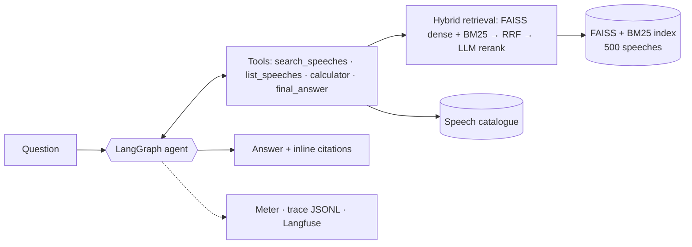

# ECB Speeches Analyst — production-grade RAG + agentic system

Generative AI I · MSc Data for Finance (Mines Paris – PSL × Albert School)

**Team:** _add names here_

An internal knowledge base of **500 speeches by ECB Executive Board members** (February 2020 – October 2026), queried by a
**LangGraph agent** that searches the speeches (hybrid FAISS + BM25 retrieval with reranking), looks up the speech
catalogue, does exact arithmetic, and answers **with a citation for every claim**. Every stage is **scored on a
held-out golden set**, with cost and latency tracked.

> Use case: an analyst on a rates or macro desk asks "What did Schnabel say about r* in 2025?", "How did inflation
> evolve between January and May 2026 according to the ECB?" or "Who spoke most in 2025?" and gets a sourced answer
> in seconds instead of reading dozens of speeches.

---

## 1. Corpus

| | |
|---|---|
| Source | Official ECB speeches dataset, `ecb.europa.eu/press/key/shared/data/all_ECB_speeches.csv` |
| Selection | 500 most recent speeches with ≥ 300 words, one per title (`scripts/download_corpus.py`) |
| Period | 11 Feb 2020 → 30 Oct 2026 |
| Size | 1.6 million words; Lagarde 125, Schnabel 75, Lane 69, Panetta 62, Elderson 59, de Guindos 52, Cipollone 46, others |
| Metadata | date, speaker(s), title, subtitle → carried into every chunk and every citation |

Why this corpus: it is real, public and large enough that retrieval is a genuine problem; positions **change over
time** (inflation in 2021 vs 2025), so dates and speakers matter for answers and citations; and it is a realistic
internal knowledge base for a bank's research or advisory team.

## 2. Architecture

See [`docs/architecture.md`](docs/architecture.md) for the full data-flow and agent-loop diagrams.



**Stack:** Mistral Small 4 (`mistralai/mistral-small-2603`) for reasoning, reranking and judging; `mistral-embed`
(1024 dims) for embeddings; both through OpenRouter. FAISS (`IndexFlatIP`), `rank-bm25`, LangGraph, Pydantic
structured outputs, Langfuse (optional), Streamlit demo.

## 3. Design decisions

| Decision | Choice | Why |
|---|---|---|
| Chunking | 3 variants compared (see §5) | Chunking is scored, not assumed. A = course baseline (200 words, 50 overlap); B = A + contextual header (speaker, title, date); C = sentence-aware packing (~250 words, 1-sentence overlap) + header |
| Contextual header | prepended before embedding and BM25 | A passage like "inflation fell to 1.7%" is useless without who said it and when; the header makes speaker and date retrievable |
| Retrieval | dense + BM25 fused by RRF (k = 60), then LLM rerank of the top-20 to top-5 | Dense handles paraphrases; BM25 handles exact figures, acronyms (TPI, PEPP, SREP) and names; the rerank funnel reads 20 candidates instead of 10,000 |
| Metadata filters | speaker and date filters inside FAISS (`IDSelectorBatch`) and BM25 | Questions are often "what did X say in year Y" |
| Agent | LangGraph state machine (agent ↔ tools), native tool calling | Explicit state, bounded loop, inspectable trace |
| Tools | `search_speeches`, `list_speeches`, `calculator`, `final_answer` | Retrieval for content, the catalogue for counts and dates (an LLM cannot count over 500 documents), exact arithmetic, explicit termination with a citation check |
| Vector store | FAISS in memory | The course requirement and enough for 10k chunks; production would move to pgvector for persistence, filtering and transactions |

## 4. Evaluation methodology

* **Golden set:** 44 questions written from the speeches, each with **hand-verified evidence spans** quoted verbatim
  from the source (`data/golden_set.jsonl`, checked by `tests/test_golden_set.py`).
  Types: 30 single-fact, 5 calculation (search + calculator), 3 multi-document, 4 metadata (catalogue), 2 unanswerable.
* **Dev / test split:** 23 dev questions are used to choose the chunking variant and the retrieval mode;
  **21 test questions are held out** and only used for the final numbers.
* **Gold chunks are variant-independent:** a chunk is gold if it covers ≥ 50% of an evidence span, so variants with
  different chunk boundaries are scored on the same facts.
* **Retrieval metrics (k = 5):** Recall@5, precision@5, MRR, nDCG@5, document hit@5. Precision@5 is capped by the
  number of gold chunks per question (usually 1–2, so a perfect score is 0.2–0.4).
* **Answer metrics:** correctness (every required figure or term must be present), RAGAS-style **faithfulness**
  (share of answer claims supported by the retrieved passages, LLM judge), evidence recall (did the agent
  retrieve a gold passage).
* **Agent metrics:** success rate, mean iterations, tool calls, **hallucinated-tool-call rate**, tool-error rate,
  termination reason, **cost per answer** and **latency p50 / p95**. The agent is compared with a single-shot RAG baseline.
* **Security:** 5 prompt-injection attacks (3 direct, 2 indirect through poisoned passages injected into an in-memory
  copy of the index); success is detected with canary strings.

## 5. Results

Generated by the scripts into [`results/`](results/). Run them once with your API key (§7), then copy the headline
numbers here.

| Table | File |
|---|---|
| Retrieval scorecard, dev (variant × mode) | `results/retrieval_dev.md` |
| Retrieval scorecard, held-out test | `results/retrieval_test.md` |
| Configuration selected on dev | `results/best_config.json` |
| Agent vs single-shot RAG, held-out test | `results/agent_test.md`, `results/agent_test_by_type.md` |
| Prompt-injection test | `results/security.md` |

**Headline (held-out test):** _success rate …, faithfulness …, MRR …, cost per answer $…, latency p50 … s, attack success rate …_

## 6. Failure handling and security

| Failure mode | Mitigation |
|---|---|
| Infinite loop | `final_answer` tool + max 8 iterations + 60k-token budget + repeated-call detection; when a bound fires, one last call without tools salvages an answer from the evidence |
| Hallucinated tool call | arguments validated against the JSON schema before execution; unknown tools return the list of valid tools |
| Error cascade | every tool error is returned as an explicit observation; the loop never crashes |
| Fabricated citation | `final_answer` rejects any source id that no tool returned during the run |
| API errors | exponential backoff on 429 / 5xx / timeouts; fatal errors fail fast; embedding batches halve on error |
| Prompt injection | retrieved text wrapped in `<document>` tags and declared as data; instruction-like passages flagged; tag characters neutralised; system-prompt instruction hierarchy; structured final answer |

## 7. How to run

```bash
python -m venv .venv && source .venv/bin/activate     # Windows: .venv\Scripts\activate
pip install -r requirements.txt
cp .env.example .env                                  # then put your OPENROUTER_API_KEY in .env

python -m pytest -q                                   # offline tests, no API call
python scripts/build_index.py                         # embeds the 3 variants (about $1, 10-20 min)
python scripts/eval_retrieval.py --split dev          # compares variants x modes, writes best_config.json
python scripts/eval_retrieval.py --split test         # held-out retrieval numbers
python scripts/eval_agent.py --split test --baseline  # agent vs single-shot RAG on the held-out set
python scripts/eval_security.py                       # prompt-injection test
python scripts/ask.py "What did Lane say about AI adoption in Europe?"
streamlit run app.py                                  # demo interface
```

`make all` runs the whole pipeline. To trace runs in Langfuse, add `LANGFUSE_PUBLIC_KEY` and `LANGFUSE_SECRET_KEY`
to `.env`; every LLM call (tokens, cost, latency) and every agent run then appears in the Langfuse project.
Without them, runs are still logged locally in `runs/` (one JSONL trace per run).

## 8. Repository structure

```
├── app.py                     Streamlit demo
├── data/
│   ├── ecb_speeches_500.jsonl Corpus (500 speeches with metadata)
│   ├── golden_set.jsonl       44 questions, evidence spans, dev/test split
│   └── security_set.jsonl     Prompt-injection attacks
├── docs/architecture.md       Data-flow and agent-loop diagrams, failure-mode table
├── results/                   Evaluation tables (generated)
├── scripts/                   download, build index, evaluations, CLI
├── src/ecbrag/                Library: chunking, index, retrieval, agent, metrics, guardrails
└── tests/                     Offline tests (pytest, run in GitHub Actions)
```

## 9. Limitations and next steps

* FAISS is in-memory; a production deployment would use pgvector (persistence, SQL filters, hybrid search in one query).
* The golden set (44 questions) is small; confidence intervals on the test numbers are wide.
* The LLM judge for faithfulness is itself a model and can be wrong; it is used as a relative signal between systems.
* Speeches only: adding press conferences, Economic Bulletins and account minutes would broaden coverage.
* No conversation memory: each question is answered independently.
