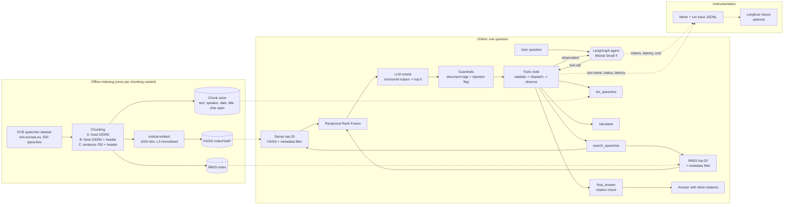
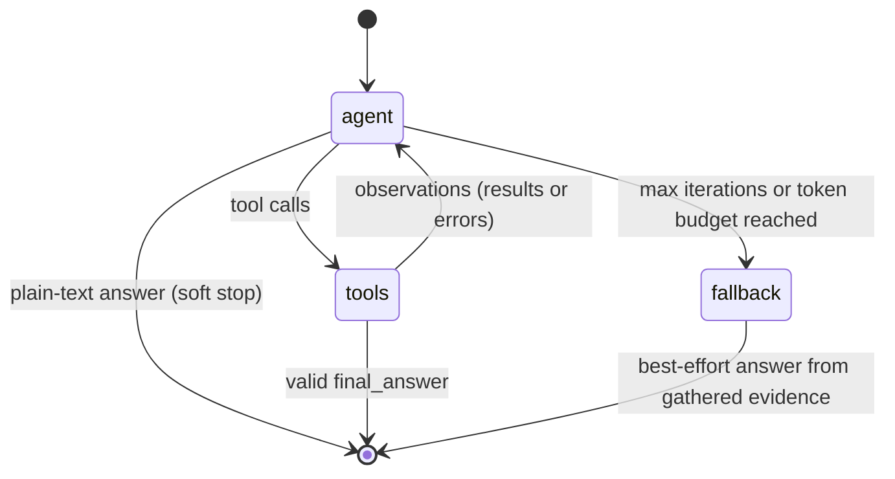

# Architecture

## Data flow

## Agent loop

## Components

| Layer | File | Role |
|---|---|---|
| Configuration | `src/ecbrag/config.py` | Paths, models, prices, chunking variants, best config selected on dev |
| LLM access | `src/ecbrag/llm.py` | Metered chat, structured output and embeddings, retries with backoff, Langfuse wrapper |
| Chunking | `src/ecbrag/chunking.py` | Fixed windows and sentence-aware packing, with character spans kept |
| Index | `src/ecbrag/index.py` | FAISS + BM25, metadata filters, persistence |
| Retrieval | `src/ecbrag/retrieval.py` | dense, BM25, hybrid RRF, hybrid + LLM rerank |
| Guardrails | `src/ecbrag/guardrails.py` | Document demarcation, injection detection, tag neutralisation |
| Agent | `src/ecbrag/agent/` | Tool registry, validation, dispatch, LangGraph state machine |
| Evaluation | `src/ecbrag/metrics.py`, `scripts/eval_*.py` | Retrieval metrics, correctness, faithfulness, agent and security scorecards |

## Failure handling

| Failure mode | Detection signal | Mitigation |
|---|---|---|
| Non-terminating loop | iteration count, token count | `final_answer` tool, max 8 iterations, 60k-token budget, repeated-call detection, fallback answer |
| Hallucinated tool call | unknown name or schema failure (counted as `hallucinated_calls`) | schema validation before execution; error message lists valid tools |
| Error cascade | tool errors counted (`tool_errors`) | errors returned as explicit observations; the model corrects its next call |
| Fabricated citation | citation check in `final_answer` | only ids returned by tools in this run can be cited |
| Empty retrieval | "No passage matched" observation | guidance to widen filters or check the speaker with `list_speeches` |
| API hiccups (429, 5xx, timeouts) | exceptions with status code | exponential backoff (5 attempts); fatal codes fail fast; embedding batches halve on error |
| Prompt injection | detector flag, canary strings in the security test | document tags, instruction hierarchy, structured final answer, citation whitelist |
| Ungrounded or hijacked answer | output guard verdict (`blocked:ungrounded`, `blocked:prompt_leak`) | post-generation check: an answer is released only if it cites sources returned by tools (or the catalogue) or is an explicit refusal, and never if it reproduces the system prompt |
